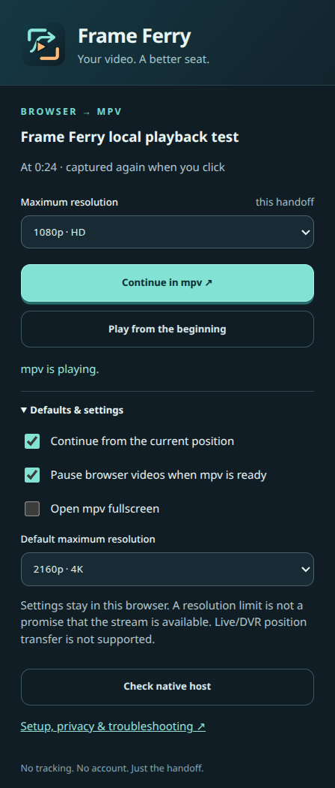

# Frame Ferry


**Send browser videos to mpv. Keep your place.**

Continue from the current position, when available, or start over. Choose a resolution limit and fullscreen playback. By default, Frame Ferry pauses accessible browser videos before it reads the position. If mpv fails to start, it tries to resume only the unchanged videos it paused. Turn browser pausing off to keep watching during startup.

Frame Ferry includes timeline previews, SponsorBlock controls, and YouTube quality recovery. It uses a separate mpv configuration, so your normal player settings stay unchanged.



## Install

Tested on **Linux x86-64 with Helium AppImage**. The installer also has registration paths for Chromium, Chrome, and Brave. The browser must be able to launch Frame Ferry's local Python helper, which runs mpv.

Flatpak/Snap browsers may work with additional host integration, but this installer does not configure or test it. Firefox, Windows, and macOS are not supported.

Install **mpv 0.41+**, **yt-dlp 2026.08+**, **Python 3.10+**, **Deno 2+**, Git, Bash, curl, patch, diffutils (`cmp`), and coreutils (`sha256sum`). Then:

```sh
git clone https://github.com/zenworr/frame-ferry.git
cd frame-ferry
./scripts/install-mpv-ui.sh
./scripts/install-mpv-sponsorblock.sh
./scripts/install.sh --browser helium
python3 scripts/doctor --browser helium
```

Replace `helium` with `chromium`, `chrome`, or `brave` as needed.

1. Open your browser's Extensions page, such as `helium://extensions`.
2. Enable **Developer mode** and select **Load unpacked**.
3. Select `~/.local/share/frameferry/extension`, or the path printed by the installer.
4. Pin Frame Ferry, open a video, and select **Continue in mpv**. **Alt+Shift+M** opens the popup.

## Controls

| Control | Action |
| --- | --- |
| Right-click | Pause / resume |
| `F2` | Change the resolution limit |
| `Ctrl+r` | Retry YouTube playback at the current position |
| `Ctrl+b` | Open YouTube in the browser; close mpv if the open command succeeds |
| `Alt+q` | Switch to the fast, lower-quality YouTube fallback |
| `Alt+s` | Toggle sponsor skipping |
| `Ctrl+h` | Change hardware decoding mode |

A 4K limit is not a guarantee of 4K playback. YouTube recovery tries the selected quality before a reduced-quality fallback. Provider restrictions can still prevent playback. Live/DVR positions do not transfer reliably.

## Frame Ferry configuration

The installer creates `~/.config/frameferry/config.json` (under `$XDG_CONFIG_HOME` when set):

```json
{
  "mpv": "",
  "yt_dlp": "",
  "deno": "",
  "recovery_timeout": 30,
  "startup_timeout": 38,
  "stall_timeout": 10,
  "http_chunk_size": 1048576,
  "log_retention": 20,
  "update_interval_hours": 24,
  "proxy": ""
}
```

- **Executables:** empty values search `PATH`, then `~/.local/bin`. Set absolute executable paths for custom installations. You can create this file before installation if the tools are not on `PATH`.
- **Timeouts:** `recovery_timeout` sets the YouTube recovery budget (10–300 seconds). `startup_timeout` sets the native helper's startup limit (up to 600 seconds and at least 8 seconds more than recovery). The browser can time out first.
- **Stall recovery:** `stall_timeout` is the continuous stall duration before automatic recovery (3–120 seconds).
- **HTTP requests:** `http_chunk_size` sets the range request size for eligible recorded YouTube streams (65,536–8,388,608 bytes). Set `0` to let mpv handle request sizes.
- **Logs and updates:** `log_retention` sets the target log count (1–1,000). `update_interval_hours` sets 1–168 hours between attempts if automatic yt-dlp updates are on.
- **Proxy:** empty means direct access. Set an HTTP proxy such as `http://127.0.0.1:8080` for extraction and playback. HTTPS video requires CONNECT support. See the [user guide](docs/guide.md#timeouts-logs-and-proxy) for details.

Omitted settings use the defaults above. Invalid values and unknown keys are rejected with an error. Protocol limits and internal polling intervals are fixed safety constants, not user settings.

These settings stay in the local helper; the extension cannot supply executable paths or proxy settings. Keep the file private if the proxy URL contains credentials. Updates preserve it. Changes apply to new handoffs; an existing updater cooldown finishes before a new interval takes effect. Run `python3 scripts/doctor --browser helium` to check the configuration without network access.

## Update or remove

To update, run `git pull`, rerun the three installer commands above, then **reload the extension**. There are no browser-store updates. The main installer preserves local configuration edits; the component installers back up files they replace.

To remove:

```sh
./scripts/install.sh --uninstall
```

Then remove the extension in your browser. History, logs, backups, and downloaded components are retained; see the [user guide](docs/guide.md#remove-or-restore) for cleanup.

## Privacy and help

The extension has no telemetry. Settings stay local. **Browser-cookie access and automatic yt-dlp updates are off by default.** Media providers and SponsorBlock receive the requests needed for their services. Review playback logs before sharing them.

- [User guide](docs/guide.md): account access, custom browser paths, optional components, and troubleshooting.
- [Development and tests](docs/development.md) · [Contributing](CONTRIBUTING.md) · [Security](SECURITY.md)

Project code and artwork: [MIT](LICENSE). The thumbfast patch and downloaded components have separate licenses; see [third-party notices](THIRD_PARTY.md).
